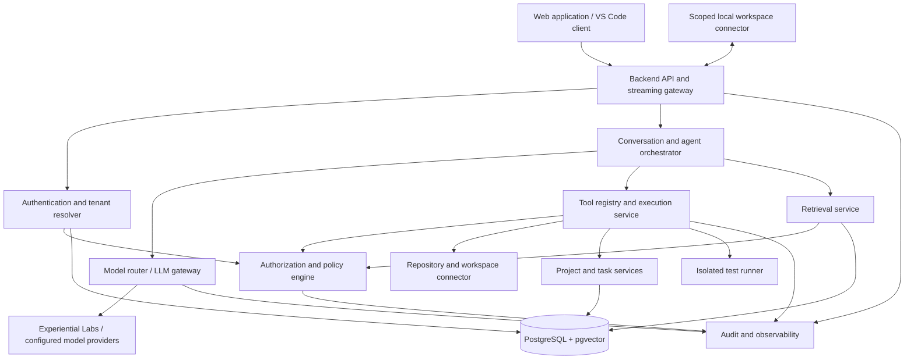

# Buildwise — Product Specification

**Version:** 1.0  
**Status:** Product and architecture baseline  
**First workspace:** Shatranj One  
**Product type:** Personal-first, multi-project AI engineering workspace with an enterprise-ready foundation

---

## 1. Product definition

**Buildwise is a project-aware AI workspace that helps an individual or team understand, build, manage, review and securely operate software projects.**

It combines a conversational assistant, project knowledge base, multi-agent workflow, project progress system, code and document access, model routing, and role-based security.

It is not a newly trained foundation model. It is an application built around existing language models, retrieval, tools, application logic and controlled data access.

The first user is the owner of the Buildwise workspace. The first connected project is Shatranj One. The same underlying platform must eventually support multiple users, teams, projects and organizations without requiring a redesign of its core data model.

### 1.1 Product goals

1. Give the AI persistent, evidence-based knowledge of each project.
2. Provide three distinct working roles: Teacher, Progress Mentor and Supervisor.
3. Let the owner control what each AI role can read, change, execute and approve.
4. Track project progress using actual evidence, not conversational claims.
5. Support multiple models and route requests according to complexity, capability and cost.
6. Protect private project information through authentication, authorization and tenant isolation.
7. Make the platform configurable enough to support a company with different employees, managers and confidential data.

### 1.2 Non-goals for the first release

- Training a foundation model from scratch.
- Building a general-purpose replacement for ChatGPT.
- Autonomous unrestricted access to the user's computer.
- A fully autonomous multi-agent organization.
- Full enterprise HR, payroll or finance integrations.
- Guaranteed elimination of prompt injection. The system will implement layered defenses and test their effectiveness.

## 2. Users, workspaces and projects

The product must distinguish the person using the platform, the project they are working on, and the AI role assisting them.

### 2.1 Initial personal workspace

- One personal tenant/workspace owned by Sumit.
- Shatranj One is the first connected project.
- The project knowledge base includes project documentation, approved source files, test evidence, decisions, reviews and progress records.
- Three AI roles are available: Teacher, Progress Mentor and Supervisor.
- The owner can invite project partners later and assign project-scoped permissions.

### 2.2 Future company workspace

A company is represented as an organization or tenant. It can contain multiple workspaces, projects, members and teams.

The model must support:

- Multiple organizations without exposing data between them.
- Multiple users in an organization.
- Multiple projects per organization.
- Different roles in different projects.
- Private and shared project resources.
- AI conversations scoped to the appropriate project and user.
- Organization-specific model and tool policies.

Being an organization member does not automatically grant access to every project or document. Membership and resource permissions are evaluated separately.

## 3. AI roles and behavior contracts

The roles are operating modes of the same platform, not three unrelated products. They share the LLM infrastructure and authorized project knowledge, but each has its own instructions, tools and permission policy.

### 3.1 Teacher

**Purpose:** Help the user understand concepts, implementation choices and the project's code.

Responsibilities:
- Explain code, algorithms, architecture and debugging findings.
- Teach incrementally using examples and questions.
- Reference the actual project files and documentation when relevant.
- Distinguish verified project facts from general explanations.
- Identify prerequisites and recommend exercises.
- Explain why a suggested change is appropriate before proposing it.

Default permissions:
- Read project files and approved documentation that the current user can access.
- Search project knowledge and inspect test output.
- Generate explanations, diagrams, snippets and proposed patches in chat.
- No direct file writes, commits, deployments or destructive commands.

Teacher acceptance criteria:
- Answers cite or identify the project sources used when project-specific facts are asserted.
- If evidence is missing, the Teacher says so instead of inventing project state.
- It does not silently change files.

### 3.2 Progress Mentor

**Purpose:** Track what was planned, what has actually been completed and what should happen next.

Responsibilities:
- Read project vision, roadmap, plans, milestones and task records.
- Compare planned milestones with evidence from files, commits, tests and user-confirmed work.
- Maintain task status and progress notes.
- Identify blockers, overdue tasks, missing tests and dependencies.
- Produce weekly or milestone progress summaries.
- Recommend a realistic next task.

Default permissions:
- Read authorized project documents, task data, Git metadata and test reports.
- Create or update tasks, progress notes and milestone proposals in the application database.
- Cannot directly change source code or project documentation.
- Cannot mark a technical feature as verified solely because a conversation says it is complete.

Progress status vocabulary:
- **Planned:** Defined but work has not been evidenced.
- **In progress:** Work has started; completion is not established.
- **Implemented:** Code or configuration exists.
- **Tested:** Relevant tests have been run and results recorded.
- **Verified:** Acceptance criteria and required evidence have been checked.
- **Blocked:** A dependency or unresolved issue prevents progress.
- **Deferred:** Intentionally postponed with a recorded reason.

### 3.3 Supervisor

**Purpose:** Act as a senior technical reviewer and implementation supervisor.

Responsibilities:
- Review a completed feature, milestone or substantial code change.
- Compare implementation with requirements and architecture decisions.
- Inspect code quality, correctness, performance, security and tests.
- Identify edge cases and missing acceptance criteria.
- Run approved tests in an isolated environment.
- Produce prioritized findings and a review decision.
- Propose patches or implementation plans.

Default permissions:
- Read authorized project files, history, documentation and test reports.
- Run an allowlisted set of non-destructive checks in a sandbox.
- Generate diffs and patch proposals.
- Write files only after explicit approval for the specific proposed change, unless the owner has separately enabled a bounded write policy.
- No unrestricted shell, credential access, deployment or destructive actions.

Review outcomes:
- **Approved:** Acceptance criteria met and no blocking finding remains.
- **Approved with follow-ups:** Main acceptance criteria met; non-blocking actions remain.
- **Changes requested:** One or more blocking findings remain.
- **Unable to verify:** Required evidence, environment or test results are unavailable.

### 3.4 Role separation is not a security boundary by itself

An agent's persona or system prompt is not an authorization mechanism. Every file read, database query, tool call and write must pass the backend policy engine. A user can also have restricted access even when interacting with the Supervisor role.

## 4. Product capabilities

### 4.1 Project workspace

Each project has:
- Overview and objectives.
- README, vision, architecture and plan documents.
- Milestones, tasks, dependencies and acceptance criteria.
- Connected repository or local workspace connector.
- Knowledge base and indexed resources.
- Conversations and AI reviews.
- Test and build evidence.
- Activity and audit history.
- Project members and permissions.

### 4.2 Project-aware chat

The user selects a project and an AI role. Each conversation is scoped to that project unless it is explicitly marked as personal or workspace-wide.

Chat capabilities:
- Streaming responses.
- Conversation history.
- Source references to files, document sections, commits or test runs.
- Attachments and document questions.
- Context controls showing which sources were used.
- Explicit distinction between verified facts, inferences and recommendations.
- User feedback on useful or incorrect answers.

### 4.3 File and repository access

The first project should connect to a scoped Shatranj One directory or repository.

Preferred connection options:
1. A local workspace connector (for example, a VS Code extension or local companion process) restricted to a folder explicitly selected by the user.
2. A Git provider integration with repository-scoped OAuth permissions.
3. Manual file or archive upload as a fallback.

The local connector must not expose the whole computer. It must enforce an explicit project root, deny path traversal and sensitive paths, and apply per-operation authorization. It should start read-only.

Initial file capabilities:
- List permitted files.
- Read selected files.
- Read file metadata and Git status.
- Create a searchable project snapshot.
- Propose a diff.
- Apply an approved diff in a later milestone.

### 4.4 Project knowledge base and RAG

Supported initial formats should include Markdown, plain text, PDF, DOCX, source code and common configuration files. Additional formats can be added through parsers.

Ingestion pipeline:
1. Authenticate the connector or uploader.
2. Verify tenant, project and resource permissions.
3. Validate file size, extension and content type.
4. Scan or quarantine untrusted files where supported.
5. Extract text and metadata.
6. Split content into chunks while retaining file path, heading, page or line references.
7. Generate embeddings using a dedicated embedding model.
8. Store chunks and embeddings with tenant, project and ACL metadata.
9. Index for hybrid lexical and vector search.
10. Record version, ingestion status and source provenance.

Retrieval pipeline:
1. Authenticate the user and determine the active project.
2. Resolve the user's effective permissions.
3. Apply tenant, project and resource filters before retrieval results enter model context.
4. Run keyword/vector retrieval; rerank when useful.
5. Remove duplicates and enforce source limits.
6. Assemble context with explicit untrusted-source boundaries and source identifiers.
7. Ask the model to answer from evidence and cite sources.
8. Validate citations and apply output checks.

RAG must not be used as the source of truth for rapidly changing structured facts such as a task's current status, a deadline, a user's schedule or a permission. Those should be read from an authoritative database or connected system through a permission-checked tool.

### 4.5 Memory

Use explicit, scoped memory rather than treating all chat history as permanent truth.

Memory types:
- User preferences: language, explanation depth and working preferences.
- Project facts: confirmed architecture decisions, project goals and conventions.
- Task context: current milestone, blockers and next steps.
- Session context: short-lived context for one conversation.

Every memory item should record its scope, source, creator, confidence, sensitivity, created/updated time and optional expiry. The user must be able to view, edit and delete memories. Sensitive data should not be stored as general AI memory.

### 4.6 Model routing and usage management

The application uses a server-side LLM gateway abstraction. Initial provider configuration can use the Experiential Labs OpenAI-compatible Chat Completions endpoint supplied by the user:

- Base URL: `https://api.experientiallabs.ai/v1`
- Model ID for Fable: `claude-fable-5.2`
- API credential: `EXPLABS_API_KEY`, stored server-side only.

Do not expose the API key in browser code, extension settings, logs, prompts or database plaintext. Use environment secrets in development and a secrets manager in deployment.

Model routing policy:
- Simple greetings and low-risk classification: small, inexpensive model or deterministic application logic.
- Project lookup: use database/retrieval tools first; call an LLM only when synthesis is needed.
- Teaching and ordinary explanations: economical capable model by default, with user override.
- Complex architecture review, difficult debugging and long-form reasoning: Fable 5.2 or another configured high-capability model.
- Sensitive operations: model choice does not change authorization requirements.

Routing must use a configured allowlist of model IDs, capability metadata, context limits and cost settings. Never invent model identifiers. Provide a manual override and a visible indication of which model handled the request. Record input/output token usage, latency, provider request ID, model ID and estimated cost where available.

A promotional free route must be treated as a separate provider/catalog configuration if Experiential Labs exposes one. The app must not assume that the standard model ID is free. Cost limits, alerts and optional hard stops are required.

### 4.7 Agent tools

Tools are backend capabilities exposed to agents through a controlled registry.

Initial tools:
- `project.search_files`
- `project.read_file`
- `project.get_file_metadata`
- `project.get_git_status`
- `project.list_commits`
- `knowledge.search`
- `tasks.list`
- `tasks.create_or_update`
- `milestones.get`
- `reviews.create`
- `tests.run_allowlisted`
- `changes.propose_diff`

Later tools:
- `changes.apply_approved_diff`
- `repository.create_branch`
- `repository.open_pull_request`
- `integrations.call_approved_api`
- `deployment.preview`

Every tool must have a typed input schema, permission requirement, risk classification, timeout, audit event and output-size limit. Tool descriptions and model arguments are untrusted; the backend validates every call.

## 5. System architecture

### 5.1 Logical architecture



### 5.2 Main components

**Frontend:** React and TypeScript application with project navigation, chat, agent-role selector, file/source viewer, task board, progress dashboard, review queue and settings.

**Backend API:** Python and FastAPI. Owns authentication integration, tenant context, project operations, chat streaming, tool execution, authorization, audit records and provider calls.

**Agent orchestrator:** Manages role instructions, context assembly, tool loops, approvals, timeouts and run state. It does not independently grant permissions.

**Policy engine:** Evaluates user, tenant, project, resource, action, agent role and environment context. Denies by default.

**RAG service:** Handles ingestion, chunking, embeddings, retrieval, citations and source provenance.

**Model gateway:** Normalizes provider calls, streaming, model routing, retries, usage accounting and provider error handling.

**Workspace connector:** A narrowly scoped bridge to a selected local repository. The connector establishes a secure outbound connection and accepts only authenticated, authorized operations.

**Test sandbox:** Executes allowlisted tests in a disposable container with restricted filesystem, network and resource access.

**Data layer:** PostgreSQL is the primary relational store. pgvector holds embeddings. Redis may be added for transient queues, caching and background jobs.

### 5.3 Request flow

For a project-aware question:
1. Client sends the message, active project and selected role.
2. Backend validates session and resolves tenant/user memberships.
3. Policy engine confirms access to the project and conversation.
4. Intent router identifies a simple answer, project lookup, teaching request, review request or action request.
5. Required structured data is retrieved through permission-checked services.
6. RAG retrieves only authorized sources.
7. Agent orchestrator assembles role instructions, conversation context and source evidence.
8. Model router chooses an allowed model based on task class, configured capabilities, budget and user override.
9. Model response is streamed to the client. Tool calls are validated and separately authorized.
10. Output is checked for unsupported claims, sensitive data leakage and citation consistency where practical.
11. Conversation, source references, usage and audit records are persisted.

A tool call is a new security decision, not an automatic extension of the model's previous permission.

## 6. Conceptual database schema

Use PostgreSQL with UUID primary keys, UTC timestamps, foreign keys, indexed tenant/project columns and soft deletion where appropriate. Almost every business entity must be tenant-scoped. Enforce tenant isolation in application services and with PostgreSQL Row-Level Security where practical.

### 6.1 Identity and tenancy

| Entity | Important fields | Purpose |
|---|---|---|
| `tenants` | id, name, type, status, created_at | Personal workspace or company boundary |
| `users` | id, email, display_name, auth_subject, status | Authenticated human identity |
| `tenant_memberships` | id, tenant_id, user_id, status, joined_at | User's membership in a tenant |
| `teams` | id, tenant_id, name, description | Optional company/team grouping |
| `team_memberships` | team_id, user_id, team_role | Membership within a team |
| `invitations` | id, tenant_id, email, invited_role, token_hash, expires_at, accepted_at | Secure onboarding |

`auth_subject` refers to the external identity provider subject. Passwords should not be stored by the application if a trusted identity provider manages authentication.

### 6.2 Projects and access control

| Entity | Important fields | Purpose |
|---|---|---|
| `projects` | id, tenant_id, name, slug, description, status, owner_user_id | Project record |
| `project_memberships` | id, tenant_id, project_id, user_id, role_id, status | User access to one project |
| `roles` | id, tenant_id nullable, name, scope, is_system_role | System or tenant-defined role |
| `permissions` | id, permission_key, description, resource_type, action | Atomic permission definitions |
| `role_permissions` | role_id, permission_id, effect | Permission mapping |
| `resource_acl` | id, tenant_id, project_id, resource_type, resource_id, subject_type, subject_id, action, effect | Resource-level grants/denials |
| `policy_rules` | id, tenant_id, name, condition_definition, effect, enabled | Contextual policy rules |

System roles should include Owner, Admin, Project Lead, Collaborator and Viewer. Tenant-defined roles can be introduced later. A role hierarchy is a convenience, not a substitute for explicit permission evaluation.

### 6.3 Project resources and knowledge

| Entity | Important fields | Purpose |
|---|---|---|
| `repositories` | id, tenant_id, project_id, provider, external_id, repo_url, default_branch, connector_status | Connected source repository |
| `workspace_connections` | id, tenant_id, project_id, connector_type, root_label, credential_ref, status, last_seen_at | Local or remote workspace connection |
| `resources` | id, tenant_id, project_id, resource_type, path, display_name, sensitivity, current_version_id | Logical files and project resources |
| `resource_versions` | id, resource_id, version, content_hash, source_ref, ingested_at, status | Version and change tracking |
| `documents` | id, resource_version_id, parser, mime_type, page_count, metadata | Parsed document metadata |
| `document_chunks` | id, tenant_id, project_id, document_id, chunk_index, content, heading, locator, token_count, acl_snapshot | Searchable text and citation locator |
| `embeddings` | chunk_id, embedding_model, vector, created_at | Vector representation; vector column uses pgvector |
| `ingestion_jobs` | id, tenant_id, project_id, resource_id, status, error, started_at, finished_at | Background indexing status |
| `knowledge_sources` | id, tenant_id, project_id, source_type, source_id, trust_level | Source provenance |

Permission changes must invalidate or refresh indexed ACL metadata. Retrieval must verify current permissions; a stale ACL snapshot cannot grant access.

### 6.4 Conversations and agents

| Entity | Important fields | Purpose |
|---|---|---|
| `conversations` | id, tenant_id, project_id nullable, owner_user_id, title, scope, created_at | Chat thread |
| `messages` | id, conversation_id, sender_type, sender_id, content, status, created_at | Conversation messages |
| `message_sources` | message_id, source_type, source_id, locator, relevance | Source citations used in a response |
| `agent_profiles` | id, tenant_id nullable, role_key, name, instructions_version, enabled | Teacher, Mentor, Supervisor configuration |
| `agent_runs` | id, tenant_id, project_id, conversation_id, agent_profile_id, user_id, model_id, status, started_at, finished_at | Agent execution record |
| `agent_run_events` | id, agent_run_id, event_type, payload_summary, created_at | Steps, retrieval and tool-call trace |
| `tool_invocations` | id, agent_run_id, tool_name, input_hash, risk_level, decision, status, result_ref | Tool execution audit |
| `approval_requests` | id, tenant_id, project_id, requested_by, action_type, action_summary, diff_ref, status, expires_at, decided_by | Human approval workflow |

### 6.5 Memory, plans and progress

| Entity | Important fields | Purpose |
|---|---|---|
| `memory_items` | id, tenant_id, owner_user_id nullable, project_id nullable, scope, memory_type, content, source_ref, confidence, sensitivity, expires_at | Explicit user/project memory |
| `milestones` | id, tenant_id, project_id, title, description, sequence, target_date, status | Project milestones |
| `tasks` | id, tenant_id, project_id, milestone_id, title, description, status, priority, assignee_id, due_date | Work items |
| `task_dependencies` | task_id, depends_on_task_id | Dependency graph |
| `acceptance_criteria` | id, task_id, description, verification_method, required | Definition of done |
| `progress_evidence` | id, task_id, evidence_type, source_ref, result, verified_by, verified_at | Proof supporting status |
| `reviews` | id, tenant_id, project_id, agent_run_id, reviewed_range, decision, summary, created_at | Supervisor review |
| `review_findings` | id, review_id, severity, file_path, locator, finding, recommendation, status | Review findings |

### 6.6 Model usage and audit

| Entity | Important fields | Purpose |
|---|---|---|
| `model_configs` | id, tenant_id nullable, provider, model_id, base_url_ref, capability_tags, enabled, budget_policy | Approved model configuration; never store raw API key here |
| `model_usage` | id, tenant_id, project_id, agent_run_id, provider, model_id, input_tokens, output_tokens, latency_ms, estimated_cost, provider_request_id | Cost and performance accounting |
| `usage_budgets` | id, tenant_id, project_id nullable, period, limit_amount, alert_threshold, hard_stop | Spending controls |
| `secret_references` | id, tenant_id, provider, vault_reference, created_by, rotated_at | Reference to an external secret store, not secret plaintext |
| `audit_events` | id, tenant_id, actor_type, actor_id, project_id, action, resource_type, resource_id, decision, reason_code, correlation_id, created_at | Security and business audit trail |

### 6.7 Core relationships

- One tenant has many memberships, teams and projects.
- One user can belong to multiple tenants.
- One project belongs to exactly one tenant.
- A project has many project memberships, resources, tasks, milestones and conversations.
- A resource has many versions; a parsed document has many chunks.
- A chunk belongs to one tenant and project and references a source document/version.
- A conversation has many messages and agent runs.
- An agent run has many events and tool invocations.
- A tool invocation may require one approval request.
- A task may have many acceptance criteria and evidence records.
- A review has many findings.
- Every security-sensitive operation creates an audit event.

## 7. Authorization and security model

### 7.1 Separate human identity, human permissions and agent capability

There are three independent questions:

1. **Who is the human?** Authentication establishes identity.
2. **What may this human access?** Authorization determines permitted data and actions.
3. **What may this AI role do on the human's behalf?** Agent capability policy restricts tools and actions.

The effective permission is the intersection of the human's permission, the agent's capability and the application's policy. The agent can never gain more access than the human or tenant policy allows.

### 7.2 Authorization evaluation

Every request should be evaluated with:

- Tenant ID.
- User ID and membership status.
- Active project and project membership.
- Resource and sensitivity label.
- Action (read, search, write, execute, approve, export, administer).
- Agent role and tool requested.
- Context (time, environment, approval state and applicable policy).

Policy defaults to deny. An explicit denial overrides a broad grant. Access should be checked on every request, not only when a user opens a project.

### 7.3 Initial personal roles

| Role | Typical access |
|---|---|
| Workspace Owner | Manage workspace, invite members, create projects, configure policies and approve privileged actions |
| Project Lead | Manage assigned project, tasks and members within granted scope |
| Collaborator | Read and update assigned project work within granted scope |
| Viewer | Read explicitly shared project resources |

The first version can have only the owner account, but the database must support these roles and project-scoped membership.

### 7.4 Agent-specific permission matrix

| Capability | Teacher | Progress Mentor | Supervisor |
|---|---|---|---|
| Read authorized project docs | Yes | Yes | Yes |
| Search authorized code | Yes | Yes, for progress evidence | Yes |
| Read task/milestone data | Yes | Yes | Yes |
| Create/update tasks | No by default | Yes, within project | Propose only |
| Update progress notes | No | Yes | Review notes only |
| Run allowlisted tests | No by default | No by default | Yes, sandboxed |
| Propose source changes | In chat only | No | Yes, as diff |
| Apply source changes | No | No | Approval required |
| Commit/push/deploy | No | No | Not in initial release |
| Change access policy | No | No | No |
| Read secrets | No | No | No |

The user's selection of a role does not bypass the user's own project membership or resource-level restrictions.

### 7.5 Sensitive company information

For future HR and salary data:
- Store structured sensitive data in a protected database, not in a broadly shared vector index.
- Enforce row/resource-level policy before retrieval.
- Do not include unauthorized rows in model context.
- Do not expose secrets or confidential fields in logs or model usage records.
- Require stronger authentication for sensitive exports or administrative actions.
- Audit each sensitive read and export.
- Use field-level redaction where roles are allowed partial records.

A prompt saying "do not reveal the CEO's salary" is not a security control. The retrieval/data layer must prevent an unauthorized user from obtaining that salary in the first place.

### 7.6 Prompt-injection and tool safety

Prompt injection cannot be reliably eliminated by a single model instruction or filter. Defenses must be layered:

1. Treat repository contents, uploaded documents, websites, logs and tool outputs as untrusted data.
2. Keep system policy and tool definitions separate from retrieved content.
3. Label and delimit untrusted sources in model context.
4. Apply authorization filters before retrieval and again before tool execution.
5. Expose only the minimum tools required for the active role.
6. Validate every tool argument against a strict schema and allowlist.
7. Require human approval for writes, shell execution beyond safe tests, exports, external side effects and destructive actions.
8. Run code and tests in isolated containers with restricted network and filesystem access.
9. Prevent tools from reading environment secrets or unrelated user directories.
10. Maintain audit trails and conduct adversarial tests with malicious documents and instructions.

Output filters are supplemental. They do not replace access control.

### 7.7 Authentication and session security

- Use a proven identity provider or established authentication library.
- Support email verification and secure session management.
- Use secure, HTTP-only, same-site cookies for browser sessions where applicable.
- Protect state-changing requests against CSRF.
- Add rate limits and login abuse protections.
- Support MFA before enterprise or privileged operations.
- Provide session revocation and invitation expiry.
- Do not implement custom password cryptography.

## 8. Mixed file permissions and approval workflow

The owner selected mixed permissions. This means different AI roles have different capabilities, with explicit owner control over risky operations.

### 8.1 Default file access

- Teacher: read-only file access; suggestions are returned in chat.
- Progress Mentor: read-only source access; may update task/progress records in the application database.
- Supervisor: read-only inspection, sandboxed tests and proposed diffs; direct file changes require approval.

### 8.2 Approval flow for a file change

1. Supervisor proposes a patch against a known file version.
2. Backend stores the patch and its target file hashes.
3. UI shows the diff, reason, affected files and risk category.
4. Owner approves or rejects the specific patch.
5. Before applying, backend re-checks user permission and verifies target hashes have not changed.
6. Patch is applied only inside the connected project root.
7. Result is recorded with actor, approver, files, hashes and timestamp.
8. Relevant tests can be run in the sandbox.

Approval is bound to the exact patch and expires. It must not grant blanket future write permission.

### 8.3 Terminal and execution policy

Initial release:
- No arbitrary shell access.
- Supervisor may run only configured build/test commands in a disposable sandbox.
- No unrestricted outbound network by default.
- No access to home directories, SSH keys, cloud credentials or environment secret stores.
- Destructive commands are blocked.

Later releases can introduce narrowly scoped command profiles and separate approvals.

## 9. Model and agent orchestration design

### 9.1 Orchestrator responsibilities

- Select role profile.
- Load authorized project and user context.
- Choose a task route and model.
- Retrieve evidence and structured state.
- Decide which allowed tools are available.
- Execute tool loops with bounded steps.
- Request approval for protected actions.
- Stream final response with citations.
- Record model usage and audit events.

### 9.2 Agent run lifecycle

`created → policy_checked → context_retrieved → model_selected → running → awaiting_approval (optional) → completed | failed | cancelled`

Runs must have maximum tool calls, maximum wall-clock time, maximum output size and budget limits. Retries must be bounded and safe to repeat.

### 9.3 Model routing policy

A deterministic router should handle obvious cases first:
- Greetings and simple UI actions: application logic or small model.
- Structured facts: permission-checked database/API lookup.
- Document questions: retrieval plus an economical synthesis model.
- Teaching: model selected by complexity and user setting.
- Complex code review and architecture reasoning: Fable 5.2 or another approved high-capability model.

A classifier may estimate complexity, but final selection must obey allowlisted models, tenant policies, budget limits and context constraints. Users may override routing when permitted.

### 9.4 Model provider abstraction

Use a provider adapter so the application is not hard-wired to one gateway. The first adapter uses the Experiential Labs OpenAI-compatible endpoint and the model ID `claude-fable-5.2` as supplied in the user's example.

Provider credentials are read by the backend from environment or a secret manager. Browser clients call the Buildwise backend, never the model provider directly.

Streaming and supported tool-call behavior must be tested through the selected endpoint. The adapter normalizes provider-specific responses, usage, errors and request identifiers.

## 10. User interface specification

### 10.1 Primary navigation

- Home / Workspace dashboard.
- Projects.
- Chat.
- Knowledge.
- Tasks and milestones.
- Reviews.
- Team and access management.
- Usage and settings.

### 10.2 Project screen

A project page should have:
- Overview and current milestone.
- Files and documentation.
- Knowledge search.
- Task board and timeline.
- AI conversation panel.
- Agent role selector.
- Review history.
- Repository connection health.

### 10.3 Chat screen

- Project selector.
- Teacher / Mentor / Supervisor selector.
- Conversation history.
- Streaming assistant response.
- Citations and source viewer.
- Model indicator and usage details.
- Pending approval cards for proposed changes.
- Feedback controls.

### 10.4 Owner controls

- Invite/revoke members.
- Manage project membership.
- Configure role permissions.
- Enable or disable agent tools.
- Set model routing and budget limits.
- Review audit history.
- Inspect and delete memory items.
- Approve or reject proposed changes.

## 11. API surface (logical contract)

The backend should expose versioned APIs. Exact endpoint paths can be finalized during implementation, but the logical operations are:

**Identity and workspace**
- Sign in/out and session information.
- List/create workspaces and projects.
- Invite and manage members.
- Resolve effective permissions.

**Project and repository**
- Get project overview.
- Connect/disconnect repository or local connector.
- List/read permitted files.
- Retrieve Git status and commit metadata.

**Knowledge**
- Upload/delete resource.
- Start/retry ingestion.
- Search knowledge.
- Get source and citation details.

**Chat and agents**
- Create/list conversations.
- Stream a message response.
- Select agent role.
- Cancel an agent run.
- Retrieve run events and citations.

**Tasks and reviews**
- CRUD tasks and milestones within permissions.
- Add progress evidence.
- Create and retrieve supervisor reviews.
- Create/list/approve/reject approval requests.

**Administration**
- Configure models and routing policies.
- Configure budgets.
- Inspect usage and audit events.

All endpoints must derive tenant and user identity from the authenticated session, not trust a client-supplied tenant ID as authority.

## 12. Repository and folder structure

Use a monorepo initially to keep shared contracts and local development manageable.

```text
buildwise/
├── apps/
│   ├── web/                    # React + TypeScript user interface
│   ├── api/                    # FastAPI application
│   └── workspace-connector/    # Scoped local/VS Code connector (later phase)
│
├── services/
│   ├── agent-orchestrator/     # Role execution, run lifecycle, tool loops
│   ├── model-gateway/          # Provider adapters, routing, usage accounting
│   ├── retrieval/              # Ingestion, chunking, indexing and RAG
│   ├── policy-engine/          # Authorization and tool policy decisions
│   └── test-runner/            # Sandboxed allowlisted checks
│
├── packages/
│   ├── contracts/              # Shared API schemas and event definitions
│   ├── agent-profiles/         # Teacher, Mentor and Supervisor policies
│   ├── ui-components/          # Shared interface components
│   └── observability/          # Logging and trace conventions
│
├── infra/
│   ├── docker/
│   ├── database/
│   ├── deployment/
│   └── monitoring/
│
├── docs/
│   ├── PRODUCT_SPEC.md
│   ├── SYSTEM_ARCHITECTURE.md
│   ├── DATA_MODEL.md
│   ├── SECURITY_MODEL.md
│   ├── AGENT_DESIGN.md
│   ├── API_CONTRACTS.md
│   ├── ADR/                    # Architecture decision records
│   └── threat-model/
│
├── tests/
│   ├── integration/
│   ├── security/
│   ├── evaluation/
│   └── end-to-end/
│
├── .env.example                # Names/placeholders only; no secrets
├── .gitignore
├── README.md
└── CONTRIBUTING.md
```

This is a target structure, not a requirement to create every service as a separate deployable process immediately. Start as a modular monolith with clear Python packages; split services only when operational needs justify it.

## 13. Recommended technology choices

| Layer | Initial choice | Reason |
|---|---|---|
| Frontend | React + TypeScript | Rich project dashboard and chat UI |
| Backend | Python + FastAPI | Strong AI/document ecosystem and typed APIs |
| Database | PostgreSQL | Relational integrity, tenant scoping and mature operations |
| Vector search | pgvector | Keeps early RAG infrastructure simple |
| Background jobs | Redis + worker queue when needed | Document parsing and indexing should not block chat requests |
| Identity | Established OIDC provider or proven auth framework | Avoid custom authentication implementation |
| LLM | Experiential Labs adapter first; provider abstraction | Use Fable while preserving future model choice |
| Embeddings | Dedicated embedding provider/model | Embedding and generation are separate capabilities |
| Sandbox | Docker with restricted capabilities | Isolate tests and tool execution |
| Observability | Structured logs, traces and metrics | Diagnose failures, latency, costs and security events |

Avoid microservices, Kubernetes and a complex multi-agent framework in the first milestone. A modular monolith is easier to develop, test and secure at this stage.

## 14. Non-functional requirements

### Security
- Tenant isolation on every project/resource query.
- Deny-by-default authorization.
- Server-side provider secrets only.
- Audited access to sensitive resources.
- No arbitrary unrestricted code execution.
- Approval before protected writes or external side effects.

### Reliability
- Persist user messages and agent run status.
- Handle provider timeouts, rate limits and malformed outputs.
- Support cancellation of long-running requests.
- Make ingestion jobs retryable and idempotent.
- Avoid duplicate tool side effects on retries.

### Performance targets for the first usable release

These are initial engineering targets to measure, not guaranteed provider SLAs:
- Typical application API response (excluding LLM generation): p95 under 500 ms in the development deployment.
- Initial chat time-to-first-token: target under 3 seconds when provider conditions permit.
- Project knowledge search: target p95 under 2 seconds for a modest first corpus.
- UI should remain usable while indexing occurs in the background.

### Cost control
- Track tokens, request count, model, latency and estimated cost per tenant/project/agent.
- Define daily and monthly budgets.
- Alert before limits are reached.
- Optionally stop non-critical calls at a hard budget limit.
- Cache only where data scope and privacy make caching safe.

### Maintainability
- Typed API contracts.
- Database migrations.
- Architecture decision records.
- Automated tests for policy decisions.
- Versioned agent instructions and model configurations.
- Reproducible local development environment.

## 15. Testing and evaluation plan

### 15.1 Functional tests
- User can create a workspace and project.
- User can connect Shatranj One and index approved files.
- Teacher answers with references to the correct project sources.
- Mentor distinguishes planned, implemented, tested and verified work.
- Supervisor creates a review with prioritized findings.
- A proposed patch can be approved, rejected or allowed to expire.
- Model usage is recorded accurately when provider usage data is available.

### 15.2 RAG evaluation
Create a fixed evaluation set from the Shatranj One documentation and source tree. Include:
- Questions with answers in README or project plans.
- Questions requiring multiple files.
- Questions with no answer in the corpus.
- Questions with outdated and current document versions.
- Questions whose answer depends on a structured task or test record rather than text retrieval.

Measure retrieval recall at k, citation correctness, answer support rate and abstention quality. Do not evaluate RAG only by whether the answer sounds plausible.

### 15.3 Authorization tests
- Viewer cannot read a private resource.
- User from tenant A cannot query tenant B's project or vector chunks.
- Teacher cannot invoke write tools.
- Mentor cannot modify source files.
- Supervisor cannot apply a patch without valid approval.
- Expired or revoked membership immediately denies access.
- User cannot approve their own privileged action if policy requires a separate approver.
- Sensitive fields do not appear in unauthorized model context, responses or logs.

### 15.4 Prompt-injection tests
Use malicious instructions in README files, PDFs, code comments, issue descriptions and tool output. Verify that:
- Retrieved content cannot alter system policy.
- The model cannot call tools outside its allowlist.
- A malicious document cannot cause unauthorized file reads.
- A tool output cannot cause secret disclosure.
- A model suggestion to run a destructive command is blocked.
- Prompt-injection detection signals are logged but are not treated as the only defense.

### 15.5 Agent quality tests
- Teacher explanation correctness and pedagogical usefulness.
- Mentor progress accuracy against known evidence.
- Supervisor review precision and false-positive rate.
- Tool-call success and policy-denial correctness.
- Model routing accuracy, latency and cost.

## 16. Phased development milestones

The phases below are ordered dependencies. Do not start all features in parallel.

### Phase 0 — Product and project baseline
Deliverables:
- Approved product specification.
- Shatranj One project profile and scope.
- Initial README, vision, roadmap and acceptance criteria imported or confirmed.
- Architecture decision records for data model, auth, connector and provider integration.

Exit criteria:
- The owner can explain the first release scope and what is explicitly deferred.
- Shatranj One repository and documentation sources are identified.

### Phase 1 — Application foundation
Deliverables:
- React application shell.
- FastAPI backend.
- PostgreSQL schema and migrations.
- Authentication and personal tenant creation.
- Project creation and membership model.
- Basic audit events.

Exit criteria:
- Owner can sign in, open a workspace and create/view Shatranj One.
- Tenant/project scoping is covered by automated tests.

### Phase 2 — Project knowledge and file access
Deliverables:
- Project resource registry.
- Read-only Shatranj One connector or controlled upload workflow.
- Document parser and indexing jobs.
- pgvector retrieval with tenant/project/ACL filters.
- Source citations in responses.

Exit criteria:
- The assistant can answer a known set of project questions with correct citations.
- It abstains when the answer is not present.
- Unauthorized resource retrieval tests pass.

### Phase 3 — Chat and model gateway
Deliverables:
- Streaming chat and conversation history.
- Experiential Labs OpenAI-compatible adapter.
- Server-side `EXPLABS_API_KEY` handling.
- Model allowlist and router.
- Usage tracking and budget controls.

Exit criteria:
- Fable 5.2 test calls succeed through the backend.
- Provider keys never reach browser code or logs.
- Usage, error and latency records are captured.
- Small/large model routing is testable and user-visible.

### Phase 4 — Three role modes
Deliverables:
- Teacher profile and read-only capabilities.
- Progress Mentor profile and task/progress capabilities.
- Supervisor profile and review workflow.
- Role selector and agent run history.

Exit criteria:
- Each role produces distinct outputs and only invokes permitted tools.
- Role choice does not bypass user authorization.

### Phase 5 — Progress tracking and technical review
Deliverables:
- Milestones, tasks, dependencies and acceptance criteria.
- Evidence links to source files, commits and test runs.
- Supervisor review records and findings.
- Owner approval/rejection interface for proposed changes.

Exit criteria:
- Progress status is evidence-backed.
- Supervisor can review a defined milestone and produce actionable findings.
- No source write occurs without valid approval.

### Phase 6 — Controlled file modifications and execution
Deliverables:
- Diff proposal and file-hash verification.
- Scoped local workspace connector or VS Code companion.
- Approval-bound patch application.
- Docker test sandbox and allowlisted commands.

Exit criteria:
- Connector can access only the approved project root.
- Path traversal and out-of-root access tests pass.
- Approved diff applies only to expected file versions.
- Tests run in isolation with restricted privileges.

### Phase 7 — Security hardening and evaluation
Deliverables:
- Threat model.
- Prompt-injection test corpus.
- Tenant isolation and sensitive-data tests.
- Audit viewer and usage dashboards.
- RAG and agent evaluation reports.

Exit criteria:
- Critical authorization tests pass.
- No known cross-tenant data leakage in the test suite.
- Tool permissions and approvals are documented.
- Evaluation results and known limitations are published.

### Phase 8 — Enterprise enablement
Deliverables:
- Organization administration and invitations.
- Configurable roles and team memberships.
- Organization/project policy management.
- Separate knowledge collections and budgets per tenant.
- Optional MFA, SSO/OIDC and enterprise audit export.
- Example HR/finance data integration using synthetic data first.

Exit criteria:
- Two test tenants cannot access one another's projects, documents, embeddings, conversations or usage records.
- Salary/HR access is enforced before retrieval and logged.
- Organization admins can manage users without automatically gaining unrestricted access to all sensitive business data unless explicitly authorized.

## 17. First workspace: Shatranj One

Shatranj One is the first real project and should be used as the proving ground for the product.

### Initial knowledge sources

Import or connect only the real files that exist in the project. Expected categories include:
- Project README and vision.
- Current implementation plan and roadmap.
- Architecture documents and design decisions.
- C++ engine source and build configuration.
- Tests and test output.
- Frontend/backend documents if those components exist in the repository.
- Git history and milestone notes, where available.

Do not assume a feature is implemented because it appears in a plan. The system should compare documentation with repository and test evidence.

### First useful workflows

**Teacher:** "Explain how this project's move generation works."  
Expected behavior: retrieve relevant source files, explain the implementation and cite paths/locations.

**Progress Mentor:** "What should I work on next?"  
Expected behavior: inspect project plan, tasks and evidence, then recommend the next dependency-ready task.

**Supervisor:** "Review the move-generation milestone."  
Expected behavior: compare the implementation with milestone acceptance criteria, inspect tests and produce findings. It must say "unable to verify" when tests or evidence are missing.

## 18. Risks and mitigations

| Risk | Mitigation |
|---|---|
| Scope becomes too large | Deliver a modular monolith and enforce phase exit criteria |
| AI invents project progress | Require file, commit, test or user-confirmed evidence |
| Unauthorized data enters prompts | Filter before retrieval; re-check before tool execution |
| Prompt injection through files | Treat all retrieved content as untrusted; restrict tools and require approvals |
| Model cost becomes unpredictable | Track usage, route by task, set budgets and hard stops |
| Provider API changes | Keep provider adapter separate from agents and business logic |
| Local connector exposes too much | Explicit project root, scoped operations, authentication and path validation |
| Autonomous edits damage project | Diff-first workflow, approval, file hashes, backups/version control and sandboxed tests |
| Embeddings become stale | Version documents and re-index when content or ACLs change |
| Role prompts drift | Version role instructions and test behavior against an evaluation suite |

## 19. Product success metrics

Initial targets should be measured against a baseline rather than treated as guaranteed outcomes.

- Project-specific answer citation correctness.
- Retrieval recall on a fixed test set.
- Percentage of unknown questions where the AI correctly abstains.
- Mentor progress-status agreement with manually verified evidence.
- Supervisor finding precision and usefulness.
- Unauthorized retrieval/tool-call denial rate.
- Cross-tenant isolation test pass rate.
- Model-routing cost per task and latency per route.
- Time required to complete a defined project review.
- Number of successful approved patch-and-test workflows.

## 20. Definition of the first complete release

The first release is complete when all of the following work in the Shatranj One workspace:

1. Owner signs in and opens the project.
2. The system indexes approved project documents and source files.
3. User can chat with Teacher, Mentor and Supervisor.
4. Project-specific answers show valid source references.
5. Teacher remains read-only.
6. Mentor updates progress records only and links each status to evidence.
7. Supervisor produces structured reviews and proposed diffs.
8. Protected file changes require explicit, patch-specific approval.
9. Fable 5.2 can be called through the backend model gateway.
10. Model usage, costs, errors and audit events are recorded.
11. Tenant, project and role authorization tests pass.
12. Prompt-injection tests demonstrate that untrusted documents cannot grant new permissions or invoke blocked tools.
13. The README, architecture diagrams, security model and evaluation report describe the implemented system accurately.

## 21. Decisions intentionally deferred

The following are not required to finalize the initial architecture and should be decided when the relevant phase begins:

- Exact identity provider.
- Exact embedding model and reranker.
- Whether the local connector is a VS Code extension or standalone companion process.
- Exact deployment provider and hosting topology.
- Exact small model for low-complexity requests.
- Enterprise SSO provider and compliance requirements.
- Whether agent profiles can be created by end users in the first enterprise release.

These choices should be made through architecture decision records after testing current provider capabilities and operational needs.

---

## Final architectural principles

1. **Project context must be evidence-based.** The assistant should know what exists, not merely what was discussed.
2. **Retrieval is permission-aware.** Unauthorized data must not enter model context.
3. **Agent roles are distinct from user permissions.** A role prompt is not an access-control system.
4. **Read first, propose second, write only with approval.** This is the default workflow for source modifications.
5. **Use structured systems for structured facts.** Deadlines, task status and schedules should come from authoritative data sources, not model guesses.
6. **Route by task, not habit.** Use deterministic logic where possible and reserve expensive reasoning for tasks that need it.
7. **Measure before claiming.** Accuracy, security, cost and progress claims must be supported by tests and records.
8. **Personal-first, enterprise-ready.** Build the tenant and permission foundations now, but defer enterprise complexity until the personal workflow is useful and stable.
